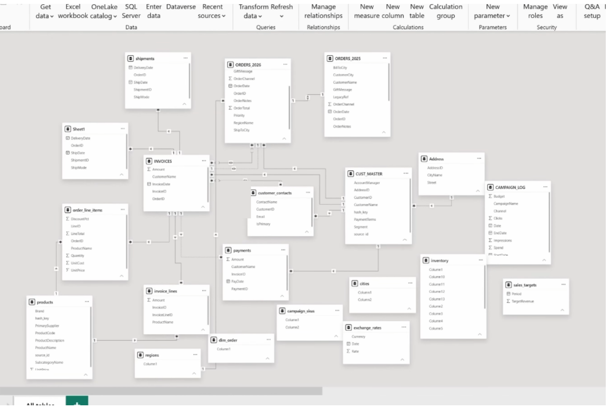
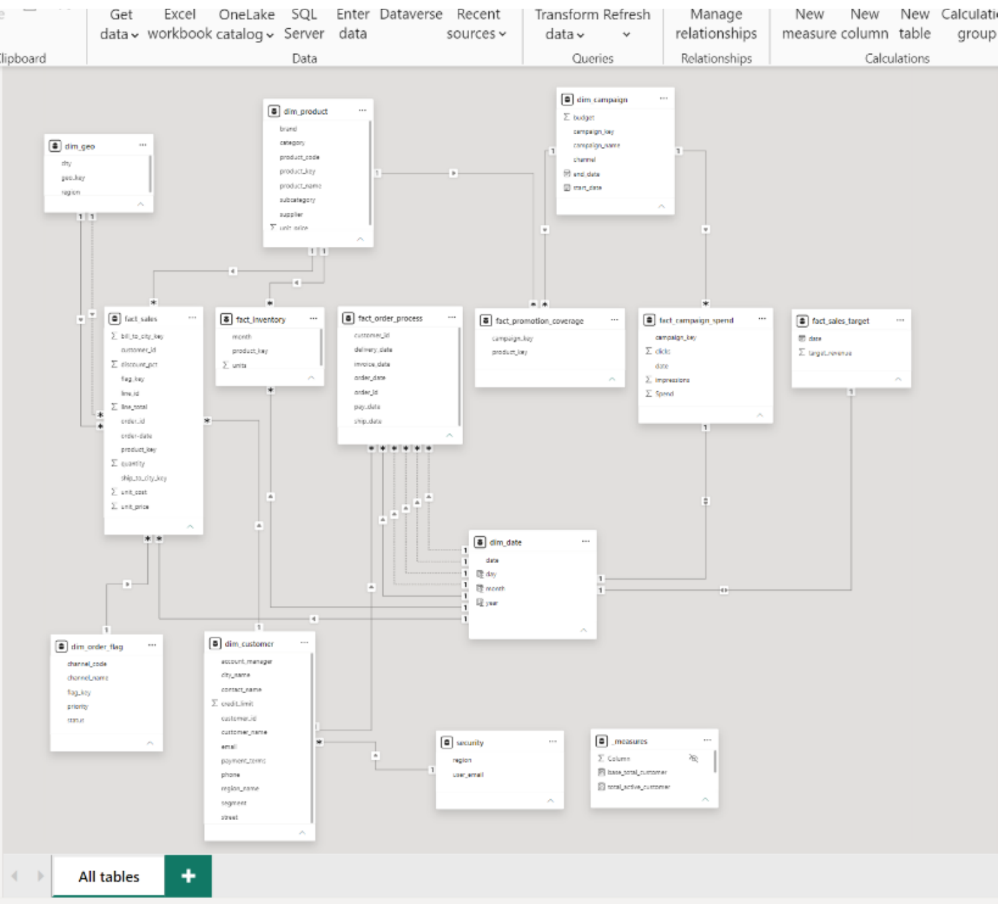

# Power BI Data Modeling: Fixing a "Nightmare" Model


A Power BI project that turns a messy, real-world-style data model into a clean **star schema** that reports can trust. The raw model had **20 tables**: duplicated order tables split by year, a stray `Sheet1` copy, columns named `Column1`, test records, comma-separated lists in a single cell, and relationships pointing in every direction. The clean model has **13 tables (6 facts, 6 dimensions, 1 security table)** and a dedicated measures table.

**[📥 Download the .pbix](Data_Modelling_Project.pbix)** · **[📄 Before / after PDF](docs/DataModel_BeforeAfter.pdf)** · Built following [Data with Baraa's "Power BI Data Modeling Portfolio Project (Nightmare Data Model)"](https://youtu.be/0A2k62YEbfI)

---

## Before and after

| Before: 20 raw tables, tangled relationships | After: clean star schema |
|---|---|
|  |  |

---

## 📑 Contents

- [What I fixed](#️-what-i-fixed)
- [The clean model](#-the-clean-model)
- [Modeling techniques used](#-modeling-techniques-used)
- [DAX measures](#-dax-measures)
- [Repository structure](#-repository-structure)
- [Next improvements](#-next-improvements)
- [How to open it](#️-how-to-open-it)

---

## 🛠️ What I fixed

| Problem in the raw model | What I did in Power Query |
|---|---|
| Test and placeholder records (customer `9999`, products `ZZZ-000`, `ELE-901`, `HOM-902`, SAP test rows) | Filtered them out before they could inflate counts |
| Customer details spread over 5 tables (master, contacts, user details, address, cities) | Merged them into one `dim_customer` with region attached |
| Product category stored in a separate lookup | Merged into `dim_product` and added a surrogate `product_key` |
| Order channel, status and priority repeated on every order | Built a small junk dimension, `dim_order_flag` (14 combinations) |
| Inventory stored wide, one column per month | Unpivoted into a long `fact_inventory` (product, month, units) |
| Promoted products stored as a comma-separated list per campaign | Split into rows and built a bridge fact, `fact_promotion_coverage` |
| Order, shipment, invoice and payment dates in 4 different tables | Combined into one process fact, `fact_order_process`, to measure order-to-cash timing |
| Inconsistent names (`CUST_MASTER`, `ORDERS_2026`, `Column1`) | Renamed everything to `snake_case` with `dim_` / `fact_` prefixes |
| No shared calendar | Added `dim_date` (`CALENDARAUTO`) with year, month and day |

All 12 Power Query scripts are in [`model/power_query/`](model/power_query/).

---

## ⭐ The clean model

| Table | Type | Rows | Grain |
|---|---|---|---|
| `fact_sales` | Fact | 200 | One row per order line |
| `fact_order_process` | Fact | 97 | Order milestones: order, ship, delivery, invoice and pay dates (80 orders; 13 have extra rows for split shipments or part-payments) |
| `fact_inventory` | Fact | 288 | Product × month stock units |
| `fact_campaign_spend` | Fact | 140 | Campaign × day impressions, clicks and spend |
| `fact_promotion_coverage` | Bridge fact | 30 | Which products each campaign promoted |
| `fact_sales_target` | Fact | 20 | Target revenue per period |
| `dim_customer` | Dimension | 60 | Customer, segment, account manager, contact, region |
| `dim_product` | Dimension | 60 | Product, brand, subcategory, category, supplier |
| `dim_geo` | Dimension | 20 | City and region |
| `dim_order_flag` | Junk dimension | 14 | Channel × status × priority |
| `dim_campaign` | Dimension | 6 | Campaign, channel, dates, budget |
| `dim_date` | Dimension | 730 | One row per day |
| `security` | Security | 5 | User email to region, for row-level security |

Full column lists: [`model/tables.md`](model/tables.md) · Relationships: [`model/relationships.md`](model/relationships.md)

**Headline figures from the model:** 526,644 in total sales across 80 orders and 200 order lines; 47 of 60 customers placed orders.

---

## 🧠 Modeling techniques used

- **Star schema:** facts in the middle, descriptive dimensions around them, all relationships many-to-one with single-direction filters.
- **Surrogate keys:** index-based keys for products, cities, campaigns and order flags.
- **Role-playing dimensions:** `dim_geo` is used twice by `fact_sales` (ship-to city active, bill-to city inactive), and `dim_date` serves several dates in `fact_order_process`. Inactive relationships can be switched on in DAX with `USERELATIONSHIP` when a report needs them.
- **Junk dimension:** low-cardinality flags (channel, status, priority) moved out of the fact table.
- **Bridge table:** resolves the many-to-many between campaigns and promoted products.
- **Unpivoting:** wide monthly columns reshaped to a long fact table.
- **Security table for row-level security:** `security` maps user emails to regions and filters `dim_customer` by region, ready for a dynamic RLS role.
- **Measures table:** all DAX measures live in `_measures`, separate from the data.

---

## 📐 DAX measures

```dax
total_sales            = SUM ( fact_sales[line_total] )
total_orders           = DISTINCTCOUNT ( fact_sales[order_id] )
total_active_customer  = DISTINCTCOUNT ( fact_sales[customer_id] )
base_total_customer    = COUNT ( dim_customer[customer_id] )
```

Source: [`model/measures.dax`](model/measures.dax).

---

## 📂 Repository structure

```text
.
├── Data_Modelling_Project.pbix   # The Power BI file (model + data)
├── docs/
│   └── DataModel_BeforeAfter.pdf # Before and after model diagrams
├── images/                       # Model screenshots used in this README
├── model/
│   ├── power_query/*.m           # Power Query (M) script for every table
│   ├── measures.dax              # DAX measures and calculated columns
│   ├── tables.md                 # Tables, row counts and columns
│   └── relationships.md          # Relationships and how dates are handled
└── README.md
```

---

## 🔜 Next improvements

- **3 sales lines have no product match** (lines `L00085`, `L00098`, `L00113`): their product names don't match the cleaned product list. A fuzzy match or a product-code join would fix this.
- **Turn off Auto date/time** so Power BI stops creating hidden date tables for campaign and target dates, and relate those columns to `dim_date` instead.
- **Define the RLS role** on the `security` table (for example `[user_email] = USERPRINCIPALNAME()`) and test it with *View as*.
- **Fix the grain of `fact_order_process`:** 13 of 80 orders have more than one row because of split shipments or part-payments, so counting rows overstates orders. Keep one row per order (first ship date, last pay date) or split shipments and payments into their own facts.
- **Rename `order-date`** in `fact_sales` to `order_date` to match the naming convention.
- **Build report pages** on top of the model (sales, order-to-cash timing, campaign ROI).

---

## ▶️ How to open it

1. Install **Power BI Desktop** (free, Microsoft Store).
2. Download [`Data_Modelling_Project.pbix`](Data_Modelling_Project.pbix) and open it. The data is stored in the file, so it opens without the source Excel workbook.
3. Go to **Model view** to see the star schema, or **Transform data** to step through the Power Query clean-up.

The raw source workbook comes from the Data with Baraa course materials and isn't included here.

---

## 👨‍💻 Author

**Parth Dhawan**: Data Analyst · SQL · Python · Excel · Power BI

[Portfolio](https://parthdhawan921-ops.github.io/Parth_Personal/) · [GitHub](https://github.com/parthdhawan921-ops) · [LinkedIn](https://www.linkedin.com/in/parth-dhawan-31516127a/)
